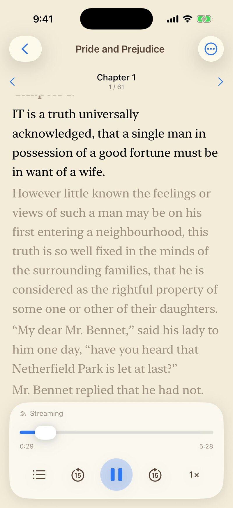
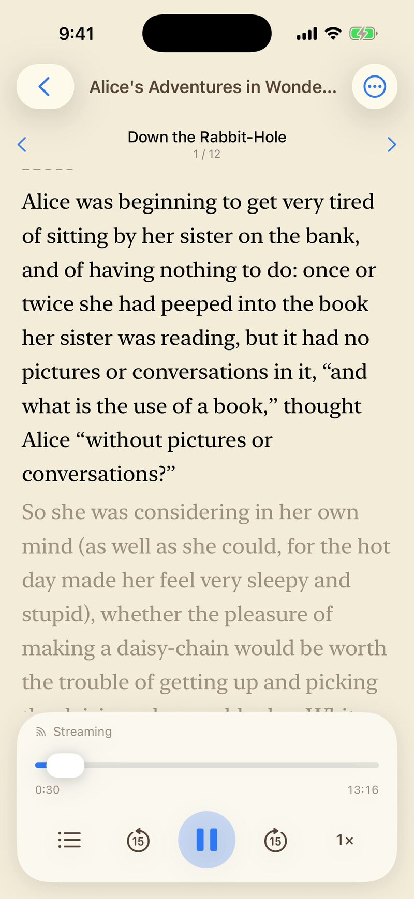
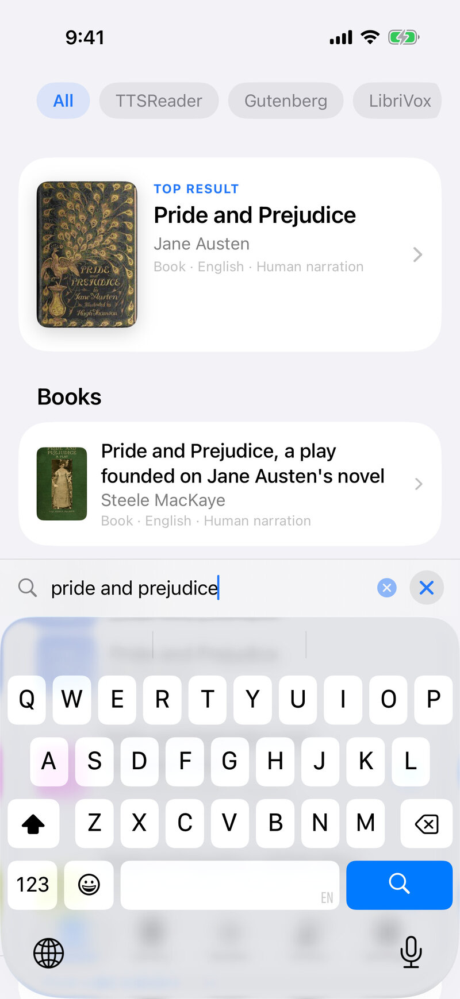
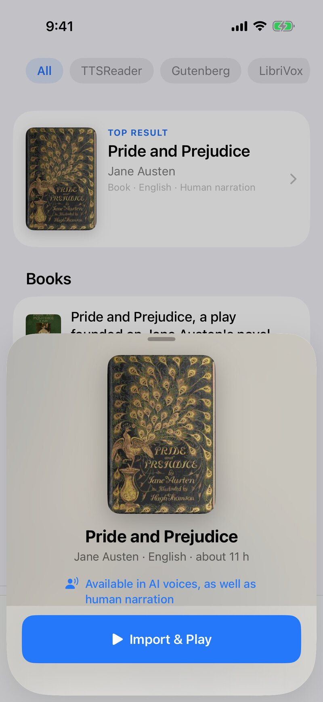
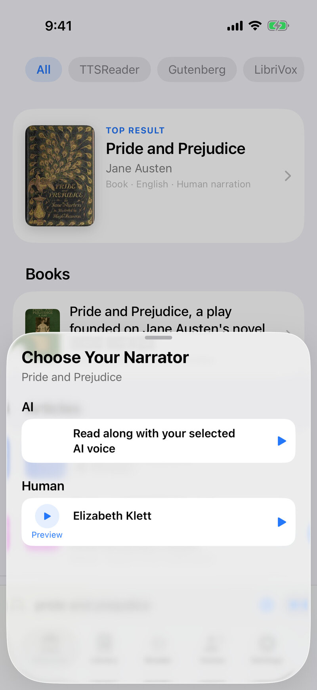
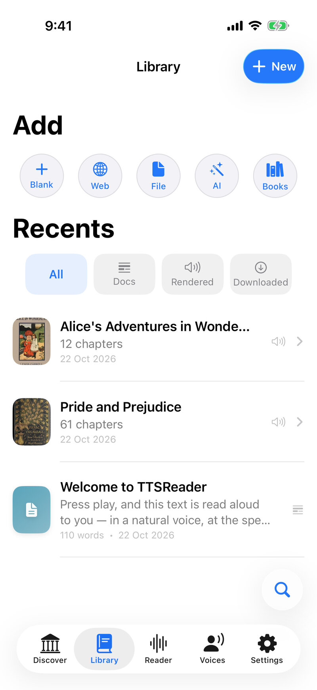

**TTSReader just got its biggest update yet.** Discover, the app's catalogue, now holds **all of Project Gutenberg, all
of LibriVox and all of Wikipedia**. It is one place to scroll and search, in 81 languages. That brings **thousands of
classic books narrated by real people** into TTSReader, free to every user.

And there is something no one else in the world offers: **579 complete LibriVox audiobooks, more than 5,000 hours of
human narration, synced to their source text sentence by sentence.** Press play, and the page follows the narrator.

  <iframe width="315"
  height="560" style="display: inline-block" src="https://www.youtube.com/embed/d3dIBVmbCNk?rel=0" title="YouTube video player - Generate audio mp3 files from synthesized speech with TTSReader" frameborder="0" allow="accelerometer; autoplay; clipboard-write; encrypted-media; gyroscope; picture-in-picture" allowfullscreen=""></iframe>

It is on **iPhone, Android and the web**, with **CarPlay, Android Auto** and full **offline** listening.

<a style="color:white;font-weight: bold" href="https://apps.apple.com/us/app/ttsreader-text-to-speech/id6790834349" target="_blank">👉 &nbsp; GET TTSREADER ON THE APP STORE</a>

 

<a style="color:white;font-weight: bold" href="https://play.google.com/store/apps/details?id=com.ttsreader.ttsreader" target="_blank">👉 &nbsp; GET TTSREADER ON GOOGLE PLAY</a>

 

<!-- VIDEO: the classics read-along video goes here once it is on YouTube (same videowrapper block as the iPhone post). -->

## What's new, in short

- **The whole public-domain library in one catalogue:** all of Project Gutenberg, all of LibriVox and all of Wikipedia,
  with scroll and search, in 81 languages.
- **More than 22,000 human-narrated audiobooks,** from LibriVox's volunteer readers, free to listen to in TTSReader.
- **A world first: human narration synced to the book.** 579 complete LibriVox audiobooks (more than 5,000 hours) are
  aligned to their source texts, sentence by sentence.
- **A Kindle-like library of free e-books,** with something Kindle doesn't do for free: the book reads itself to you,
  and you can follow along.
- **Built for listening anywhere:** offline downloads, CarPlay and Android Auto, bookmarks, and a library that keeps your
  place in every book.

## Human narration, synced to the text: a world first

LibriVox volunteers have recorded more than 22,000 public-domain books over more than twenty years. Until now, listening to one
meant audio only: no text, no way to see where you are, no way to find a passage.

We transcribed **579 complete LibriVox audiobooks** and **aligned each one to its source text**. That is 16,097
chapters and more than 5,000 hours of human narration. As far as we know, we are the first and only ones in the world to
do this.

While a recording plays, the sentence being read lights up on the page, and the page scrolls with the narrator.

**What the sync gives you:**

1. **Follow the text** as a real person reads it: a better way to learn a language, to study a classic, or simply to
   stay focused.
2. **Switch between reading and listening** whenever it suits you: read on the train, listen while you walk, and pick up
   at the same sentence.
3. **Search the text** to find a specific passage in the recording.

Here is Alice in Wonderland, read by Kara Shallenberg, with its opening on the page as she reads it:

## Which books are synced?

We started with the books people read most: **the 500 most-downloaded books on Project Gutenberg**, each with the
LibriVox recording TTSReader plays by default. Most are in English, with French, Spanish, German, Dutch, Italian and
Portuguese titles too. Among them:

- Pride and Prejudice, Emma and Sense and Sensibility (Jane Austen)
- Moby-Dick (Herman Melville)
- Frankenstein (Mary Shelley)
- Dracula (Bram Stoker)
- Jane Eyre (Charlotte Brontë)
- Alice's Adventures in Wonderland (Lewis Carroll)
- The Adventures of Sherlock Holmes (Arthur Conan Doyle)
- The Picture of Dorian Gray (Oscar Wilde)
- The Great Gatsby (F. Scott Fitzgerald)
- Little Women (Louisa May Alcott)
- Wuthering Heights (Emily Brontë)
- Peter Pan (J. M. Barrie)
- The Secret Garden (Frances Hodgson Burnett)
- The Odyssey (Homer)
- Crime and Punishment (Fyodor Dostoyevsky)
- A Christmas Carol (Charles Dickens)

More are on the way.

## All of Project Gutenberg: a free, Kindle-like library that reads to you

All of Project Gutenberg's nearly 80,000 free e-books (79,537 in our catalogue) are in Discover. Open any of them and it becomes a book in your
Library, chapters and all, with the reading themes, fonts and text sizes you'd expect from an e-reader.

The difference: every book can also **read itself to you**, in natural AI voices or in your device's own voices, with
the current sentence highlighted as it goes. And for the 500 books above, you can choose a **real person's narration**
instead.

## The best place to listen to any LibriVox audiobook

Every LibriVox recording, more than 22,000 of them, is in Discover, searchable by title or author, next to the book it reads. Open a book's card
to choose how to listen: a person reading it, or one of our AI voices.

What TTSReader adds to every LibriVox audiobook:

1. **Bookmarks and your place saved,** chapter and second, and synced across your devices.
2. **Offline downloads** of the whole book, for commutes, flights, trips and buildings with no signal.
3. **On the road:** TTSReader plays on **CarPlay** and **Android Auto**.
4. **A library for many books at once.** Listen to several books in turn, and each one keeps its own place.
5. **Free.** No charge per book or per reading. The human-narrated recordings are free to all our users, and so are your
   device's voices.

## And all of Wikipedia

Discover also holds all of Wikipedia, with shelves of articles in 81 languages. Any article opens as a clean document,
ready to be read aloud.

## Where to get it

TTSReader is on the **App Store** and **Google Play**, and online at [ttsreader.com](https://ttsreader.com/player/).

## Questions and answers

**What is a synced audiobook?**
An audiobook whose recording is aligned to the book's text, so the app always knows which sentence is being read. In
TTSReader, that sentence lights up as the narrator reads it, and the page follows.

**How many audiobooks are synced?**
579 complete LibriVox audiobooks, more than 5,000 hours of human narration, covering the 500 most-downloaded books on
Project Gutenberg.

**Is it free?**
Yes. The human-narrated LibriVox recordings and the device voices are free for every TTSReader user, with no charge per
book.

**Who are the narrators?**
LibriVox volunteers, who record public-domain books and give the recordings to the public domain. TTSReader names the
narrator of every recording.

**Can I listen offline?**
Yes. Download a whole book, and both the audio and the text are on your device.

**Does it work in the car?**
Yes, on CarPlay and Android Auto.

**Which devices?**
iPhone, Android phones and the web.

## Thank you

A big thank-you to the volunteers of [LibriVox](https://librivox.org/), who recorded these books and gave them to the
public domain, and to [Project Gutenberg](https://www.gutenberg.org/), which keeps the texts free for everyone.

<a style="color:white;font-weight: bold" href="https://apps.apple.com/us/app/ttsreader-text-to-speech/id6790834349" target="_blank">👉 &nbsp; GET TTSREADER ON THE APP STORE</a>

 

<a style="color:white;font-weight: bold" href="https://play.google.com/store/apps/details?id=com.ttsreader.ttsreader" target="_blank">👉 &nbsp; GET TTSREADER ON GOOGLE PLAY</a>

