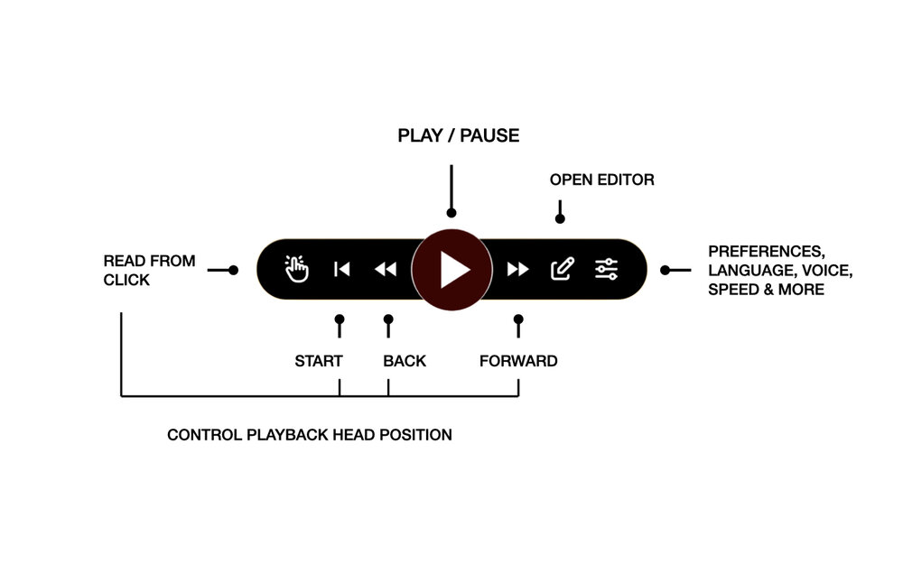
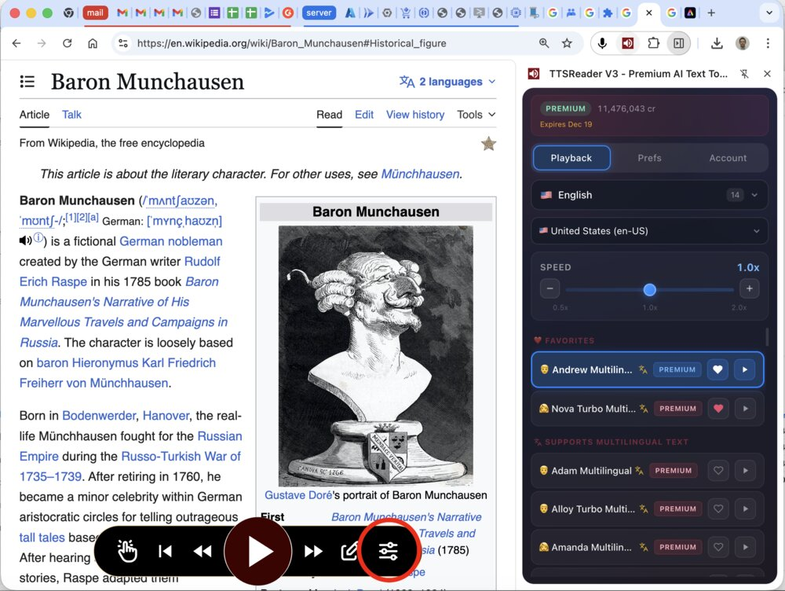
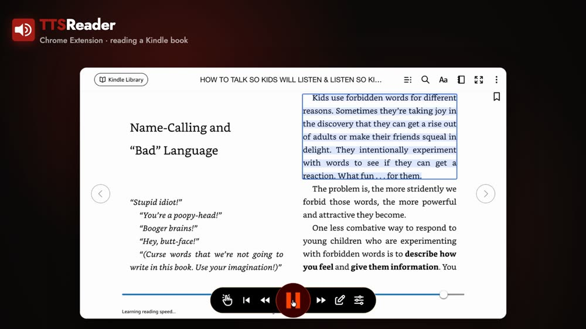

You can have your Kindle books read out loud on your computer, so you can listen while you cook or tidy up, or when your
eyes need a rest. To do this, you add TTSReader to your browser and open your book on Amazon's Kindle website. This guide
takes you through it from the start. You don't need any experience with browser extensions.

  <iframe style="display: block" src="https://www.youtube.com/embed/DXCHDYDm5AI?rel=0" title="YouTube video player - The TTSReader Chrome extension reading a Kindle book out loud and turning the page" frameborder="0" allow="accelerometer; autoplay; clipboard-write; encrypted-media; gyroscope; picture-in-picture" allowfullscreen=""></iframe>

 

## What you need

- A computer with the Chrome or Edge browser.
- An Amazon account with a Kindle book.
- A Google or Apple account, to sign in to TTSReader.

## Set up TTSReader

### Step 1: Install the TTSReader extension

An extension is a small program you add to your browser. Open the
[TTSReader page in the Chrome Web Store](https://chromewebstore.google.com/detail/ttsreader-v3-premium-ai-t/kimpjeeihakmgdlnkjaapkdikpjccabi)
and click **Add to Chrome**. When your browser asks you to confirm, click **Add extension**. In Edge, the page first asks
you to allow extensions from other stores.

### Step 2: Sign in and go through the onboarding

After you install it, TTSReader opens a welcome page. Click **Continue with Google** or **Continue with Apple** to sign
in, then click **Get Started**. A short tour of six screens follows. Click **Next** to move through it. Two things in it
matter most:

- **Pin the extension.** This keeps TTSReader's button next to your browser's address bar, where you'll use it every time.
  The tour shows you how, and it goes on once you've done it. Click the puzzle-piece icon next to the address bar, then
  click the pin next to TTSReader. A small red speaker icon now sits next to the address bar:

  

- **Choose a voice you like.** The tour shows you where the voices are. You can change the voice at any time, as Step 8
  explains.

When the tour ends, go on to Step 3.

### Step 3: Open a Wikipedia article to test it

Before you open your book, test TTSReader on an ordinary web page. Open the
[Wikipedia article about the Beatles](https://en.wikipedia.org/wiki/The_Beatles).

### Step 4: Start TTSReader on the page

TTSReader is careful with your privacy. It adds nothing to the websites you visit, and it doesn't read a website unless
you ask it to. So each time you want a website read to you, you do two things: open the website, then click TTSReader's
button, the small red speaker icon next to the address bar in Chrome or Edge. This example shows a different article:

The TTSReader player, a black bar of buttons, appears on the page. Click the big round **Play** button in the middle to
hear the article, and click it again to pause. If you heard the article, everything works.

## Listen to your Kindle book

### Step 5: Open your Kindle book

Go to [read.amazon.com](https://read.amazon.com/). This is Kindle Cloud Reader, Amazon's website for reading Kindle books.
Sign in with your Amazon account if it asks you to, then click the book you want to hear.

### Step 6: Start TTSReader on the book

Click TTSReader's button next to the address bar, as you did on Wikipedia. The player appears over your book.

### Step 7: Click Play

Click the big round **Play** button in the middle of the player. That's all there is to it. You'll hear TTSReader reading
the page on your screen, and you'll see the sentence it's reading marked on the page.

### Step 8: Choose a voice and a speed

This step is optional. Click the settings button at the right end of the player, the one with three sliders, to open
TTSReader's side panel, which appears beside the page.

TTSReader has hundreds of leading AI voices. In the side panel, choose a language, click the small play button next to a
voice to hear it, and click the voice you like best. Use the **Speed** slider to set the reading speed. Voices marked **PREMIUM** are AI voices.

### Step 9: Sit back and listen

TTSReader reads through your book, marks the sentence it's reading, and turns the pages for you. It keeps going until you
pause it or the book ends.

## Pricing

TTSReader is free to install and try. There are two kinds of voices, and both read Kindle books:

- **Device voices** are the voices that come with your browser and computer. They're free, with no limit.
- **Premium AI voices** are the natural-sounding voices. You pay for them by the character, meaning each letter, space or
  punctuation mark that's read. You can try them with 5,000 free characters, about five minutes of listening. After
  that, you can switch to a device voice, or get a Premium plan. It costs $10.99 a month, or $99 a year ($8.25 a month),
  and includes 1 million characters a month, about 18 hours of listening. It comes with a 30-day money-back guarantee.

As far as we know, this is the best plan of its kind in the world. You can see every option on the
[Plans & Pricing](/docs/support/pricing/) page.

## What else the extension reads

The same extension reads much more than Kindle books:

- Any web page, such as a news story, an article or a blog post.
- PDF files that you open in Chrome.
- Only the text you select on a page.
- Text you've typed into a box on a page, such as a message you're writing.
- Social media feeds. As new posts load, TTSReader goes on reading them.

## What else your account includes

The account you just made also works across all of [TTSReader.com](https://ttsreader.com/), including
[thousands of classic books read by real people](/blog/ttsreader-now-holds-all-of-project-gutenberg-and-all-of-librivox-with-5000-hours-of-human-narration-synced-to-the-text/).
If you buy a Premium plan, you only need to buy it once.

## Common questions

### Why do I have to click the button on every website?

This is how TTSReader protects your privacy. It only has access to a website after you click its button on that tab.

### Why does TTSReader ask me to sign in?

You need to sign in to play anything, even with the free device voices. You can use a Google or Apple account.

### Do I have to turn the pages myself?

No. TTSReader turns each page when it finishes reading it. If you press **Play** on a page with no text, such as a cover or
a picture, TTSReader asks you to turn the page and press **Play** again.

### Does this work on a phone, in the Kindle app or on a Kindle device?

No. The extension runs in a browser on a computer, and it reads books that are open at read.amazon.com.

### Does it work in Microsoft Edge?

Yes. Install it from the same Chrome Web Store page. Edge first asks you to allow extensions from other stores.

### Which languages can it read in Kindle books?

TTSReader reads Kindle books in English today, and we're working on more languages. On other websites, it reads many more
languages.

### Does TTSReader keep the text of my book?

No. TTSReader doesn't store your text on its servers or use it to train AI. It sends only the next section to the voice
service, to make the audio, and the audio goes straight to your computer.
